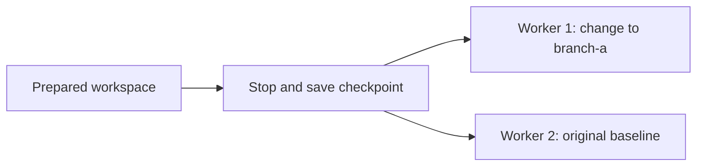

Set up your tools and project once. Save a **checkpoint**, then create independent boxes with the same files and configuration.

A checkpoint captures a stopped box's disk and execution configuration. It does not preserve memory or running processes, and each restored box gets a new ID.

## Create a checkpoint and restore two boxes

Create a project file, save it in a checkpoint, and restore it in a new box. Then change one copy and create another: the second starts from your saved baseline.



### Before you start

Use a [Cloud API key](/cloud/api-keys) with permission to create and delete boxes. This walkthrough creates one source box, two workers, and one checkpoint.

**CLI:** follow the steps below in the same terminal. **Python or TypeScript:** install your SDK below, then run the [complete example](#complete-sdk-examples). The SDK snippets in each step explain the corresponding part of that program.

<Tabs>
<Tab title="CLI">
Install the latest CLI and log in, pasting your Cloud API key at the prompt:

```bash
curl -fsSL https://sh.boxlite.ai | sh
boxlite --context app auth login --url https://api.boxlite.ai --method api-key
```
`app` names your saved context. Keep this Bash or Zsh terminal open for every step below.
</Tab>
<Tab title="Python">
```bash
python3 -m venv .venv
source .venv/bin/activate
python -m pip install --upgrade boxlite
```
The complete example prompts for your Cloud API key.
</Tab>
<Tab title="TypeScript">
Install the SDK and enter your Cloud API key on your workstation (Bash or Zsh):

```bash
npm install @boxlite-ai/boxlite tsx
read -r -s BOXLITE_API_KEY
export BOXLITE_API_KEY
```
</Tab>
</Tabs>

### 1. Prepare your workspace

Create a box and write a project file containing `baseline`. In your own workflow, this is where you would install tools or prepare project files before saving them.

<Tabs>
<Tab title="CLI">

```bash
SOURCE=$(boxlite --context app create --auto-stop 0 --auto-delete 0 python:alpine)
printf 'Source: %s\n' "$SOURCE"
boxlite --context app start "$SOURCE" >/dev/null
boxlite --context app exec "$SOURCE" -- sh -c "mkdir -p /workspace; printf 'baseline\n' > /workspace/project.txt; sync"
boxlite --context app exec "$SOURCE" -- cat /workspace/project.txt
```

</Tab>
<Tab title="Python">

```python
source = await runtime.create(boxlite.BoxOptions(
    image="python:alpine", auto_stop=0, auto_delete=0,
))
print("Source:", source.id)
await source.start()
await run(source, "mkdir -p /workspace; printf 'baseline\n' > /workspace/project.txt; sync")
await run(source, "cat /workspace/project.txt")
```

</Tab>
<Tab title="TypeScript">

```typescript
var source = await runtime.create({ image: 'python:alpine', autoStop: 0, autoDelete: 0 });
console.log('Source:', source.id);
await source.start();
await run(source, "mkdir -p /workspace; printf 'baseline\n' > /workspace/project.txt; sync");
await run(source, 'cat /workspace/project.txt');
```

</Tab>
</Tabs>

The final line should be:

```text
baseline
```

Save the printed source ID. The example disables idle-stop and automatic deletion so the box stays available while you work. Clean up at the end; choose your production [lifecycle settings](/cloud/box-lifecycle) before capturing your own box.

### 2. Save a checkpoint

Stop the source before capture, then wait for the checkpoint to become `ready`. Keep the source stopped until capture finishes.

<Tabs>
<Tab title="CLI">

```bash
boxlite --context app stop "$SOURCE"
boxlite --context app inspect "$SOURCE" --format '{{.State.Status}}'
```

Continue only when the status is `stopped`. If needed, repeat the inspect command. Then capture the box:

```bash
CHECKPOINT=$(boxlite --context app checkpoint create "$SOURCE")
printf 'Checkpoint: %s\n' "$CHECKPOINT"
boxlite --context app checkpoint get "$CHECKPOINT"
```

Repeat `boxlite --context app checkpoint get "$CHECKPOINT"` until `state` is `ready`. If it is `failed`, read `error_reason` and stop here.

</Tab>
<Tab title="Python">

```python
await source.stop()
# Wait until the source status is stopped (see complete example).
checkpoint = await runtime.checkpoints.create(source.id)
# Wait until checkpoint.state is ready before creating a worker.
```

</Tab>
<Tab title="TypeScript">

```typescript
await source.stop();
// Wait until the source status is stopped (see complete example).
const checkpoint = await runtime.checkpoints.create(source.id);
// Wait until checkpoint.state is ready before creating a worker.
```

</Tab>
</Tabs>

**Do not proceed until the checkpoint is `ready`.** Save its printed ID: you can use it again from another session, even after deleting the source box.

### 3. Restore and verify your files

Create a new box using only the checkpoint. No image or configuration overrides are needed: the saved settings are inherited.

<Tabs>
<Tab title="CLI">

```bash
WORKER1=$(boxlite --context app create --checkpoint "$CHECKPOINT")
printf 'Worker 1: %s\n' "$WORKER1"
boxlite --context app start "$WORKER1" >/dev/null
boxlite --context app exec "$WORKER1" -- cat /workspace/project.txt
```

</Tab>
<Tab title="Python">

```python
worker1 = await runtime.create(boxlite.BoxOptions(checkpoint=checkpoint.id))
print("Worker 1:", worker1.id)
await worker1.start()
await run(worker1, "cat /workspace/project.txt")
```

</Tab>
<Tab title="TypeScript">

```typescript
var worker1 = await runtime.create({ checkpoint: checkpoint.id });
console.log('Worker 1:', worker1.id);
await worker1.start();
await run(worker1, 'cat /workspace/project.txt');
```

</Tab>
</Tabs>

The new box prints `baseline` even though you never wrote that file into it. Its worker ID is different from the source ID.

### 4. Create an independent second copy

Change the first worker's file to `branch-a`, then create a second worker from the same checkpoint. Read both files:

<Tabs>
<Tab title="CLI">

```bash
boxlite --context app exec "$WORKER1" -- sh -c "printf 'branch-a\n' > /workspace/project.txt"
WORKER2=$(boxlite --context app create --checkpoint "$CHECKPOINT")
printf 'Worker 2: %s\n' "$WORKER2"
boxlite --context app start "$WORKER2" >/dev/null
boxlite --context app exec "$WORKER1" -- cat /workspace/project.txt
boxlite --context app exec "$WORKER2" -- cat /workspace/project.txt
```

</Tab>
<Tab title="Python">

```python
await run(worker1, "printf 'branch-a\n' > /workspace/project.txt")
worker2 = await runtime.create(boxlite.BoxOptions(checkpoint=checkpoint.id))
print("Worker 2:", worker2.id)
await worker2.start()
await run(worker1, "cat /workspace/project.txt")
await run(worker2, "cat /workspace/project.txt")
```

</Tab>
<Tab title="TypeScript">

```typescript
await run(worker1, "printf 'branch-a\n' > /workspace/project.txt");
var worker2 = await runtime.create({ checkpoint: checkpoint.id });
console.log('Worker 2:', worker2.id);
await worker2.start();
await run(worker1, 'cat /workspace/project.txt');
await run(worker2, 'cat /workspace/project.txt');
```

</Tab>
</Tabs>

After the second worker ID, you should see:

```text
branch-a
baseline
```

The first worker contains your change. The second starts from the saved baseline: editing a worker does not change the checkpoint or other workers.

**Your checkpoint is still available.** Keep it to create more workers, or remove the demo resources when you are done.

### 5. Clean up when you are done

Keep the checkpoint if you want to create more workers. When finished, remove the demo resources yourself; none of the examples delete them automatically.

For the CLI walkthrough, the IDs are still in your shell variables:

```bash
boxlite --context app rm --force "$WORKER1" "$WORKER2" "$SOURCE"
boxlite --context app checkpoint delete "$CHECKPOINT"
```

For an SDK run, or after closing the terminal, use the printed IDs with the [cleanup commands](#clean-up). The workers remain running until you stop or remove them.

## Complete SDK examples

Run one of these programs after installing its dependencies above. It performs steps 1–4, prints each resource ID, and leaves the checkpoint and boxes available for you to explore. Run step 5 when you are done.

If a run fails, keep the IDs already printed and inspect those resources before retrying.

<AccordionGroup>
<Accordion title="Python: complete runnable example">
Save as `checkpoint_demo.py`:

```python checkpoint_demo.py
import asyncio
from getpass import getpass
import boxlite

async def main():
    runtime = boxlite.Boxlite.rest(boxlite.BoxliteRestOptions(
        url="https://api.boxlite.ai",
        credential=boxlite.ApiKeyCredential(getpass("BoxLite Cloud API key: ")),
    ))

    async def run(box, command):
        execution = await box.exec("sh", args=["-c", command])
        async def read(stream):
            return "".join([chunk async for chunk in stream])
        output, error = await asyncio.gather(
            read(execution.stdout()), read(execution.stderr()))
        result = await execution.wait()
        if result.exit_code != 0:
            raise RuntimeError(f"Command failed ({result.exit_code}): {error}")
        print(output.strip())

    try:
        source = await runtime.create(boxlite.BoxOptions(
            image="python:alpine", auto_stop=0, auto_delete=0,
        ))
        print("Source:", source.id)
        await source.start()
        await run(source, "mkdir -p /workspace; printf 'baseline\n' > /workspace/project.txt; sync")
        await run(source, "cat /workspace/project.txt")

        await source.stop()
        for _ in range(60):
            if (await runtime.get_info(source.id)).state.status == "stopped":
                break
            await asyncio.sleep(1)
        else:
            raise TimeoutError(f"Check source status: {source.id}")

        checkpoint = await runtime.checkpoints.create(source.id)
        print("Checkpoint:", checkpoint.id)
        for _ in range(180):
            checkpoint = await runtime.checkpoints.get(checkpoint.id)
            if checkpoint.state == "ready":
                break
            if checkpoint.state in ("failed", "deleting"):
                raise RuntimeError(f"{checkpoint.state}: {checkpoint.error_reason}")
            await asyncio.sleep(1)
        else:
            raise TimeoutError(f"Check checkpoint status: {checkpoint.id}")

        print(checkpoint.state)

        worker1 = await runtime.create(boxlite.BoxOptions(checkpoint=checkpoint.id))
        print("Worker 1:", worker1.id)
        await worker1.start()
        await run(worker1, "cat /workspace/project.txt")

        await run(worker1, "printf 'branch-a\n' > /workspace/project.txt")
        worker2 = await runtime.create(boxlite.BoxOptions(checkpoint=checkpoint.id))
        print("Worker 2:", worker2.id)
        await worker2.start()
        await run(worker1, "cat /workspace/project.txt")
        await run(worker2, "cat /workspace/project.txt")
        print("Keep these IDs to reuse the checkpoint or clean up later.")
    finally:
        runtime.close()

asyncio.run(main())
```

```bash
python checkpoint_demo.py
```
</Accordion>
<Accordion title="TypeScript: complete runnable example">
Save as `checkpoint_demo.ts`:

```typescript checkpoint_demo.ts
async function main() {
  const key = process.env.BOXLITE_API_KEY;
  if (!key) throw new Error('Set BOXLITE_API_KEY on your workstation');
  var { ApiKeyCredential, BoxliteRestOptions, JsBoxlite } = await import('@boxlite-ai/boxlite');
  var runtime = JsBoxlite.rest(new BoxliteRestOptions({
    url: 'https://api.boxlite.ai',
    credential: new ApiKeyCredential(key),
  }));
  var sleep = () => new Promise(resolve => setTimeout(resolve, 1000));
  async function run(box: Awaited<ReturnType<typeof runtime.create>>, command: string) {
    const execution = await box.exec('sh', ['-c', command]);
    const stdout = await execution.stdout();
    const stderr = await execution.stderr();
    async function read(stream: typeof stdout) {
      let text = '';
      for (let chunk = await stream.next(); chunk !== null; chunk = await stream.next()) text += chunk;
      return text;
    }
    const [output, error] = await Promise.all([read(stdout), read(stderr)]);
    const result = await execution.wait();
    if (result.exitCode !== 0) throw new Error(`Command failed (${result.exitCode}): ${error}`);
    console.log(output.trim());
  }

  try {
    var source = await runtime.create({ image: 'python:alpine', autoStop: 0, autoDelete: 0 });
    console.log('Source:', source.id);
    await source.start();
    await run(source, "mkdir -p /workspace; printf 'baseline\n' > /workspace/project.txt; sync");
    await run(source, 'cat /workspace/project.txt');

    await source.stop();
    var stopped = false;
    for (let attempt = 0; attempt < 60; attempt++) {
      if ((await runtime.getInfo(source.id))?.state.status === 'stopped') { stopped = true; break; }
      await sleep();
    }
    if (!stopped) throw new Error(`Check source status: ${source.id}`);

    var checkpoint = await runtime.checkpoints.create(source.id);
    console.log('Checkpoint:', checkpoint.id);
    for (let attempt = 0; attempt < 180; attempt++) {
      checkpoint = await runtime.checkpoints.get(checkpoint.id);
      if (checkpoint.state === 'ready') break;
      if (['failed', 'deleting'].includes(checkpoint.state)) {
        throw new Error(`${checkpoint.state}: ${checkpoint.errorReason}`);
      }
      await sleep();
    }
    if (checkpoint.state !== 'ready') throw new Error(`Check checkpoint status: ${checkpoint.id}`);
    console.log(checkpoint.state);

    var worker1 = await runtime.create({ checkpoint: checkpoint.id });
    console.log('Worker 1:', worker1.id);
    await worker1.start();
    await run(worker1, 'cat /workspace/project.txt');

    await run(worker1, "printf 'branch-a\n' > /workspace/project.txt");
    var worker2 = await runtime.create({ checkpoint: checkpoint.id });
    console.log('Worker 2:', worker2.id);
    await worker2.start();
    await run(worker1, 'cat /workspace/project.txt');
    await run(worker2, 'cat /workspace/project.txt');
    console.log('Keep these IDs to reuse the checkpoint or clean up later.');
  } finally {
    runtime.close();
  }
}
main().catch(error => { console.error(error); process.exitCode = 1; });
```

```bash
npx tsx checkpoint_demo.ts
```
</Accordion>
</AccordionGroup>

## Capture your own box

Finish writes and stop your application's work before stopping the box. Check that its status is `stopped`; checkpoint creation does not stop it for you. Keep it stopped and available until the checkpoint reaches `ready`.

A source box **cannot have attached volumes or Secrets**. Save reusable tools and project files in a box without those attachments. Files already written into its root disk are included in the checkpoint, so remove credentials you do not want copied before capture.

You can give a checkpoint a memorable name:

<Tabs>
<Tab title="Python">
```python
checkpoint = await runtime.checkpoints.create(source.id, name="prepared-workspace")
```
</Tab>
<Tab title="TypeScript">
```typescript
const checkpoint = await runtime.checkpoints.create(source.id, 'prepared-workspace');
```
</Tab>
<Tab title="CLI">
```bash
boxlite --context app checkpoint create '<SOURCE_BOX_ID>' --name prepared-workspace
boxlite --context app checkpoint get prepared-workspace
```
</Tab>
</Tabs>

Creation returns before capture finishes. Use the waiting loop from step 2, or query the checkpoint until it is `ready`:

| State | What to do |
|---|---|
| `creating` | Wait and query again; do not delete or restart the source. |
| `ready` | Create boxes from the checkpoint; you can now change or delete the source. |
| `failed` | Read `error_reason`, resolve the cause, and create a new checkpoint. |
| `deleting` | Wait for deletion to finish; do not use it for new boxes. |

Names accept letters, digits, `.`, `_`, and `-`, start with a letter or digit, and have at most 128 characters. Omitting a name generates one. Get, create-from-checkpoint, and delete accept an ID or name.

## Reuse a checkpoint in another session

Use its saved ID or name in `BoxOptions(checkpoint=...)`, `{ checkpoint: ... }`, or `boxlite create --checkpoint ...`. An optional new box name is the only creation override.

Do not also pass an image, resource settings, empty lists, or lifecycle defaults: restored boxes inherit the saved configuration, and overrides are rejected.

## What is preserved?

| Preserved | Behavior after restoration |
|---|---|
| Root disk | Files, installed packages, and project changes exist as they did at capture time. |
| Execution configuration | Environment variables, entrypoint, command, user, and working directory are inherited. |
| Resource and placement settings | CPU, memory, disk, region, and class are inherited; creation still needs quota and available capacity. |
| Network and lifecycle configuration | Saved settings are inherited, including idle-stop and automatic deletion. |

Memory, running processes, and open connections are not preserved. A restored box has a new identity. Reconnect clients to that new box, and launch your application through its saved startup command or a new execution.

Checkpoint restoration creates a new box; it does not roll back or replace an existing box. For ongoing data shared across boxes, use [Volumes](/cloud/volumes). For restarting the same box, see [Box lifecycle](/cloud/box-lifecycle).

## List and inspect checkpoints

<Tabs>
<Tab title="Python">
```python
items = await runtime.checkpoints.list()
info = await runtime.checkpoints.get("prepared-workspace")
print(info.id, info.state, info.size_bytes, info.error_reason)
```
</Tab>
<Tab title="TypeScript">
```typescript
const items = await runtime.checkpoints.list();
const info = await runtime.checkpoints.get('prepared-workspace');
console.log(info.id, info.state, info.sizeBytes, info.errorReason);
```
</Tab>
<Tab title="CLI">
```bash
boxlite --context app checkpoint list
boxlite --context app checkpoint get prepared-workspace
```
</Tab>
</Tabs>

SDK and CLI list operations fetch all pages. CLI lists also support `--format json`, `--format yaml`, or `--quiet` for IDs only. Do not combine `--quiet` with `--format`.

## Clean up

A ready checkpoint is independent of its source. Deleting the source does not delete the checkpoint; deleting the checkpoint does not delete boxes already restored from it.

If you have closed the walkthrough session, replace the placeholders with the IDs it printed. Run these commands from a terminal logged into the `app` context:

```bash
boxlite --context app rm --force '<WORKER_1_ID>' '<WORKER_2_ID>' '<SOURCE_BOX_ID>'
boxlite --context app checkpoint delete '<CHECKPOINT_ID>'
```

For checkpoint deletion, `force=True` (Python), `true` (TypeScript), or `--force` (CLI) only ignores a missing checkpoint. It does not bypass an active capture or restore operation.

## Troubleshooting

| Symptom | Next step |
|---|---|
| Source must be idle and stopped | Stop it, wait for `stopped`, and let pending operations finish before capturing. |
| Volumes or secrets are not supported | Use a source without those attachments. |
| Saved settings must be inherited | Remove every creation option except `checkpoint` and the new box name. |
| Waiting times out | Query the existing checkpoint by its printed ID; a client timeout does not establish that the server failed. |
| Creating a worker times out | Inspect the box ID in the error, or look it up by the name you supplied, before creating another. |
| Checkpoint is being created or used | Wait for the operation to finish. If restoration failed, remove the failed target box before retrying deletion. |
| Checkpoint limit reached | List your checkpoints and delete unneeded ones. |

For differences from local snapshots and portable archives, see [Cloud vs open source](/cloud/vs-opensource).
