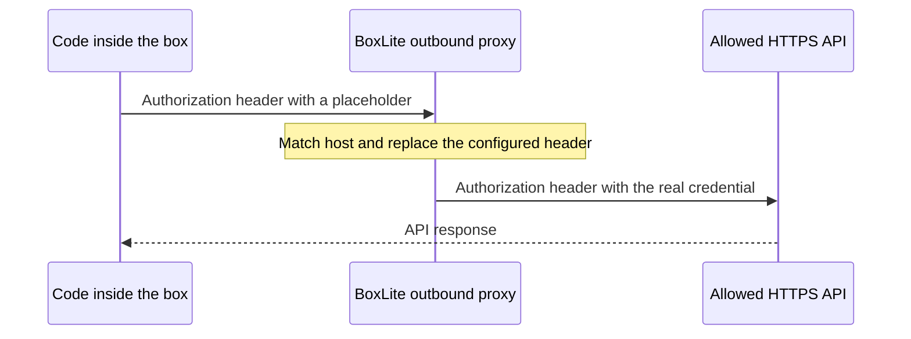

Let code inside your box call an authenticated HTTPS API while keeping the credential out of its environment and configuration files. Supply the real value when you create the box; BoxLite's outbound proxy inserts it into selected request headers.

Your application uses a placeholder such as `<BOXLITE_SECRET:model>`. You choose which destination hosts and headers receive the real value.

## Make your first LLM call

Run one inference request inside a box. Your workstation supplies the real model key to BoxLite; the code inside the box sends only `<BOXLITE_SECRET:model>` and receives the model's reply.

You need an OpenAI API key with access to `gpt-4.1-mini` and a [BoxLite Cloud API key](/cloud/api-keys). Run the commands on your workstation. The examples create a disposable box, print the reply, and remove the box automatically.

Using another OpenAI-compatible provider? Change `api.openai.com` in both the Secret host and request URL, and change the model ID. Use that provider's key. The real key still belongs only in the Secret configuration.

<Tabs>
<Tab title="Python">

```bash
python3 -m venv .venv
source .venv/bin/activate
python -m pip install --upgrade boxlite
```

Save as `llm_secret.py` and paste your **BoxLite Cloud API key**, then your **OpenAI API key**, at the prompts:

```python llm_secret.py
import asyncio
import json
from getpass import getpass

import boxlite


async def main():
    cloud_key = getpass("BoxLite Cloud API key: ")
    runtime = boxlite.Boxlite.rest(boxlite.BoxliteRestOptions(
        url="https://api.boxlite.ai",
        credential=boxlite.ApiKeyCredential(cloud_key),
    ))
    token = getpass("OpenAI API key: ")
    box = None

    async def run(command, args):
        execution = await box.exec(command, args=args)
        output = "".join([part async for part in execution.stdout()])
        result = await execution.wait()
        if result.exit_code != 0:
            raise RuntimeError(f"{command} failed with exit code {result.exit_code}")
        return output

    try:
        box = await runtime.create(boxlite.BoxOptions(
            image="python:alpine",
            auto_stop=0,
            auto_delete=0,
            secrets=[boxlite.Secret(
                name="model",
                value=token,
                hosts=["api.openai.com"],
                headers={"Authorization": "Bearer {value}"},
            )],
        ))
        print(f"Created box: {box.id}")
        await box.start()
        request = """
import json, ssl, urllib.request
payload = {
    "model": "gpt-4.1-mini",
    "messages": [{"role": "user", "content": "Say hello in one short sentence."}],
    "max_tokens": 64,
}
request = urllib.request.Request(
    "https://api.openai.com/v1/chat/completions",
    data=json.dumps(payload).encode(),
    headers={
        "Content-Type": "application/json",
        "Authorization": "Bearer <BOXLITE_SECRET:model>",
    },
)
context = ssl.create_default_context(cafile="/etc/ssl/certs/ca-certificates.crt")
with urllib.request.urlopen(request, context=context, timeout=60) as response:
    print(json.load(response)["choices"][0]["message"]["content"])
"""
        print((await run("python", ["-c", request])).strip())
    finally:
        try:
            if box is not None:
                await runtime.remove(box.id, force=True)
                print("Removed the test box")
        finally:
            runtime.close()


asyncio.run(main())

```

```bash
python llm_secret.py
```

</Tab>
<Tab title="TypeScript">

```bash
npm install @boxlite-ai/boxlite tsx
```

Enter your Cloud API key, then your provider key, on your workstation (Bash or Zsh):

```bash
read -r -s "BOXLITE_API_KEY"
export BOXLITE_API_KEY
read -r -s OPENAI_API_KEY
export OPENAI_API_KEY
```

Save as `llm_secret.ts`:

```typescript llm_secret.ts
import { ApiKeyCredential, BoxliteRestOptions, JsBoxlite } from '@boxlite-ai/boxlite';

async function main() {
  const cloudKey = process.env.BOXLITE_API_KEY;
  if (!cloudKey) throw new Error('Set BOXLITE_API_KEY on your workstation');
  const runtime = JsBoxlite.rest(new BoxliteRestOptions({
    url: 'https://api.boxlite.ai', credential: new ApiKeyCredential(cloudKey),
  }));
  const token = process.env.OPENAI_API_KEY;
  if (!token) throw new Error('Set OPENAI_API_KEY on your workstation');
  let box: Awaited<ReturnType<typeof runtime.create>> | undefined;
  async function run(command: string, args: string[]) {
    const execution = await box!.exec(command, args);
    const stdout = await execution.stdout();
    let output = '';
    for (let chunk = await stdout.next(); chunk !== null; chunk = await stdout.next()) output += chunk;
    const result = await execution.wait();
    if (result.exitCode !== 0) throw new Error(`${command} failed: ${result.exitCode}`);
    return output;
  }
  try {
    box = await runtime.create({ image: 'python:alpine', autoStop: 0, autoDelete: 0,
      secrets: [{name: 'model', value: token, hosts: ['api.openai.com'],
        headers: { Authorization: 'Bearer {value}' }}],
    });
    console.log(`Created box: ${box.id}`);
    await box.start();
    const request = `
import json, ssl, urllib.request
payload = {
    "model": "gpt-4.1-mini",
    "messages": [{"role": "user", "content": "Say hello in one short sentence."}],
    "max_tokens": 64,
}
request = urllib.request.Request(
    "https://api.openai.com/v1/chat/completions",
    data=json.dumps(payload).encode(),
    headers={
        "Content-Type": "application/json",
        "Authorization": "Bearer <BOXLITE_SECRET:model>",
    },
)
context = ssl.create_default_context(cafile="/etc/ssl/certs/ca-certificates.crt")
with urllib.request.urlopen(request, context=context, timeout=60) as response:
    print(json.load(response)["choices"][0]["message"]["content"])
`;
    console.log((await run("python", ["-c", request])).trim());
  } finally {
    try { if (box) { await runtime.remove(box.id, true); console.log('Removed the test box'); } }
    finally { runtime.close(); }
  }
}
main().catch(error => { console.error(error); process.exitCode = 1; });

```

```bash
npx tsx llm_secret.ts
```

</Tab>
<Tab title="CLI + REST">

The CLI has no Secret-creation flag. This shell workflow creates the box through the REST API, then uses `boxlite exec` to run inference. Do not put the real credential in `boxlite create -e`.

Install the latest CLI. You also need Bash, `curl`, and `jq` on your workstation:

```bash
curl -fsSL https://sh.boxlite.ai | sh
```

Save as `llm_secret.sh`:

```bash llm_secret.sh
#!/usr/bin/env bash
set -euo pipefail
BASE='https://api.boxlite.ai'
if [[ -z "${BOXLITE_API_KEY:-}" ]]; then
  read -r -s -p 'BoxLite Cloud API key: ' BOXLITE_API_KEY
  printf '\n'
fi
export BOXLITE_API_KEY
WORK=$(mktemp -d)
BOX=''
api() {
  local route=$1
  shift
  printf 'header = "Authorization: Bearer %s"\n' "$BOXLITE_API_KEY" |
    curl -q --config - --fail --silent --show-error "$BASE/v1$route" "$@"
}
cleanup() {
  if [[ -n "$BOX" ]]; then
    if api "/boxes/$BOX?force=true" -X DELETE >/dev/null; then
      printf 'Removed the test box\n'
    else
      printf 'Cleanup failed; remove box %s in the console\n' "$BOX" >&2
    fi
  fi
  rm -rf "$WORK"
}
trap cleanup EXIT
read -r -s -p 'OpenAI API key: ' OPENAI_API_KEY
printf '\n'
export OPENAI_API_KEY
jq -n '{image:"python:alpine",auto_stop:0,auto_delete:0,
  secrets:[{name:"model",value:env.OPENAI_API_KEY,hosts:["api.openai.com"],
    headers:{Authorization:"Bearer {value}"}}]}' > "$WORK/create.json"
unset OPENAI_API_KEY
BOX=$(api /boxes -H 'Content-Type: application/json' \
  --data-binary @"$WORK/create.json" | jq -er '.box_id')
printf 'Created box: %s\n' "$BOX"
boxcli() { boxlite --home "$WORK/home" --url "$BASE" --path-prefix '' "$@"; }
boxcli start "$BOX" >/dev/null
REQUEST=$(cat <<'PY'
import json, ssl, urllib.request
payload = {
    "model": "gpt-4.1-mini",
    "messages": [{"role": "user", "content": "Say hello in one short sentence."}],
    "max_tokens": 64,
}
request = urllib.request.Request(
    "https://api.openai.com/v1/chat/completions",
    data=json.dumps(payload).encode(),
    headers={
        "Content-Type": "application/json",
        "Authorization": "Bearer <BOXLITE_SECRET:model>",
    },
)
context = ssl.create_default_context(cafile="/etc/ssl/certs/ca-certificates.crt")
with urllib.request.urlopen(request, context=context, timeout=60) as response:
    print(json.load(response)["choices"][0]["message"]["content"])
PY
)
boxcli exec "$BOX" -- python -c "$REQUEST"

```

```bash
bash llm_secret.sh
```

</Tab>
</Tabs>
Expected output (the model's wording can vary):

```text
Created box: <BOX_ID>
Hello! How can I help you today?
Removed the test box
```

A successful authenticated model response demonstrates that the proxy injected a usable credential. The model key is supplied only to `Secret.value`; it is not passed to the guest command or guest environment.

## How it works



A Secret is configured on a box through `BoxOptions.secrets`. This guide does not require a separate secret-store setup or a public tunnel.

<Note>
A Secret controls where a credential is injected. It does not restrict all outbound traffic. Use [network policy](/cloud/network-policy#outbound-what-the-box-can-reach) if you also need to limit which destinations the box can reach.
</Note>

## Connect your own API

Once the demo works, configure your production box with the API's real hostname, credential, and authentication header. Read the real credential on your workstation or trusted backend:

<Tabs>
<Tab title="Python">
```python
from getpass import getpass
import boxlite

provider_secret = boxlite.Secret(
    name="model",
    value=getpass("Provider API key: "),
    hosts=["api.your-provider.com"],
    headers={"Authorization": "Bearer {value}"},
)
# Pass secrets=[provider_secret] to BoxOptions when creating the box.
```
</Tab>
<Tab title="TypeScript">
```typescript
// This runs on the trusted workstation or backend, outside the box.
const providerKey = process.env.PROVIDER_API_KEY;
if (!providerKey) throw new Error("Set PROVIDER_API_KEY on the host");
const providerSecret = {
  name: "model",
  value: providerKey,
  hosts: ["api.your-provider.com"],
  headers: { Authorization: "Bearer {value}" },
};
// Pass secrets: [providerSecret] in runtime.create(...).
```
</Tab>
<Tab title="CLI + REST">
The `POST /v1/boxes` request accepts the same configuration in JSON:

```json
{
  "secrets": [{
    "name": "model",
    "value": "<YOUR_PROVIDER_KEY>",
    "hosts": ["api.your-provider.com"],
    "headers": {"Authorization": "Bearer {value}"}
  }]
}
```

Merge this field into the create request. Supply the real value from your trusted host's secret store; avoid placing it in shell history or committing it to a JSON file. The shell example keeps its request body in a restricted temporary directory and deletes it during cleanup.
</Tab>
</Tabs>

Replace `api.your-provider.com` with the hostname from your API URL, without `https://` or a path. Pass `secrets=[provider_secret]` in the `BoxOptions` used to create your box.

Inside the box, configure your HTTP client or agent with the placeholder **`<BOXLITE_SECRET:model>`**, not the real key. For example, the request should contain:

```text
Authorization: Bearer <BOXLITE_SECRET:model>
```

If your agent requires an environment variable such as `OPENAI_API_KEY`, set that variable to the placeholder through the box environment configuration:

Python uses `env=[("OPENAI_API_KEY", "<BOXLITE_SECRET:model>")]`; TypeScript uses `env: [{ key: "OPENAI_API_KEY", value: "<BOXLITE_SECRET:model>" }]`; the REST create body uses `"env": {"OPENAI_API_KEY": "<BOXLITE_SECRET:model>"}`. Keep the Secret configuration alongside it.

Configure the agent's API base URL separately. It must use the hostname you listed in `hosts`.

Validate with a read-only endpoint on the real provider that requires authentication. Check for its expected successful response; do not print authorization headers or full debug request logs.

### Choose the authentication header

Use the header required by your API:

| API authentication | Secret `headers` | Header sent from inside the box |
|---|---|---|
| Bearer token | `{"Authorization": "Bearer {value}"}` | `Authorization: Bearer <BOXLITE_SECRET:model>` |
| API-key header | `{"X-Api-Key": "{value}"}` | `X-Api-Key: <BOXLITE_SECRET:model>` |

`{value}` is the proxy's template variable. `<BOXLITE_SECRET:model>` is the dummy value used by your application. They have different roles; keep the real credential only in `Secret.value`.

**The request must already contain the configured header.** BoxLite replaces its value when the host matches, even if the original value is empty or differs from the placeholder. It does not add a missing header. Other headers remain unchanged.

This is header injection, not a general search-and-replace operation over URLs, query strings, or request bodies. It is intended for authenticated HTTPS APIs, not credentials needed by a process locally.

## Restart, replace, or retire a credential

A box retains its Secret configuration across a stop/start. You do not need to pass the key again each time you resume it.

To adopt a new credential using the workflow in this guide, create a replacement box with the updated Secret, verify authentication, then move work to it. Changing a local Python variable does not update a box that already exists.

Remove a box when you no longer need it. Deleting the box does not revoke the credential at its provider; revoke the provider key separately when retiring it.

For agents with a public service, you can [move a fixed domain to the replacement box](/cloud/domains#move-the-service-without-changing-its-url).

## Security boundaries

- Keep real keys out of `BoxOptions.env`, images, uploaded files, agent prompts, and commands executed inside the box.
- Use the narrowest destination hosts and provider permissions your application needs. Code in the box can use the credential's authority at those hosts.
- A trusted destination receives the real credential. If it reflects the value in its response, code in the box can read that response.
- Keep TLS verification enabled. With a custom image or HTTP library, ensure it trusts the box's proxy CA through the system CA bundle.

## Optional: verify injection with a fake token

Use this diagnostic when you want to check the mechanism without a provider account. It verifies both the guest environment and the header received by the upstream.

<Warning>
Use only the generated fake token with this echo service. Its response returns the token to the box. Never substitute a real credential here; do not assume upstream responses are scrubbed.
</Warning>

<Accordion title="Run the fake-token diagnostic">
<Tabs>
<Tab title="Python">

```bash
python3 -m venv .venv
source .venv/bin/activate
python -m pip install --upgrade boxlite
```

Save as `secret_demo.py` and paste your **BoxLite Cloud API key** when prompted:

```python secret_demo.py
import asyncio
import json
import secrets
from getpass import getpass

import boxlite


async def main():
    cloud_key = getpass("BoxLite Cloud API key: ")
    runtime = boxlite.Boxlite.rest(boxlite.BoxliteRestOptions(
        url="https://api.boxlite.ai",
        credential=boxlite.ApiKeyCredential(cloud_key),
    ))
    token = "demo-not-a-real-key-" + secrets.token_hex(16)
    box = None

    async def run(command, args):
        execution = await box.exec(command, args=args)
        output = "".join([part async for part in execution.stdout()])
        result = await execution.wait()
        if result.exit_code != 0:
            raise RuntimeError(f"{command} failed with exit code {result.exit_code}")
        return output

    try:
        box = await runtime.create(boxlite.BoxOptions(
            image="python:alpine",
            auto_stop=0,
            auto_delete=0,
            secrets=[boxlite.Secret(
                name="demo",
                value=token,
                hosts=["httpbingo.org"],
                headers={"Authorization": "Bearer {value}"},
            )],
        ))
        print(f"Created box: {box.id}")
        await box.start()
        environment = await run("env", [])
        if not environment.strip() or token in environment:
            raise RuntimeError("Guest environment check failed")
        print("PASS: the test value is absent from the guest environment")

        request = """
import json, ssl, urllib.request
request = urllib.request.Request(
    "https://httpbingo.org/headers",
    headers={"Authorization": "Bearer <BOXLITE_SECRET:demo>"},
)
context = ssl.create_default_context(cafile="/etc/ssl/certs/ca-certificates.crt")
with urllib.request.urlopen(request, context=context, timeout=30) as response:
    print(response.read().decode())
"""
        echoed = json.loads(await run("python", ["-c", request]))
        headers = {key.lower(): value for key, value in echoed["headers"].items()}
        authorization = headers.get("authorization")
        if isinstance(authorization, list):
            authorization = authorization[0]
        if authorization != "Bearer " + token:
            raise RuntimeError("Upstream did not receive the injected test value")
        print("PASS: the upstream received the injected Authorization header")
    finally:
        try:
            if box is not None:
                await runtime.remove(box.id, force=True)
                print("Removed the test box")
        finally:
            runtime.close()


asyncio.run(main())

```

```bash
python secret_demo.py
```

</Tab>
<Tab title="TypeScript">

```bash
npm install @boxlite-ai/boxlite tsx
```

Read your Cloud API key on your workstation (Bash or Zsh), then run the example:

```bash
read -r -s "BOXLITE_API_KEY"
export BOXLITE_API_KEY
```

Save as `secret_demo.ts`:

```typescript secret_demo.ts
import { randomBytes } from 'node:crypto';
import { ApiKeyCredential, BoxliteRestOptions, JsBoxlite } from '@boxlite-ai/boxlite';

async function main() {
  const cloudKey = process.env.BOXLITE_API_KEY;
  if (!cloudKey) throw new Error('Set BOXLITE_API_KEY on your workstation');
  const runtime = JsBoxlite.rest(new BoxliteRestOptions({
    url: 'https://api.boxlite.ai', credential: new ApiKeyCredential(cloudKey),
  }));
  const token = 'demo-not-a-real-key-' + randomBytes(16).toString('hex');
  let box: Awaited<ReturnType<typeof runtime.create>> | undefined;
  async function run(command: string, args: string[]) {
    const execution = await box!.exec(command, args);
    const stdout = await execution.stdout();
    let output = '';
    for (let chunk = await stdout.next(); chunk !== null; chunk = await stdout.next()) output += chunk;
    const result = await execution.wait();
    if (result.exitCode !== 0) throw new Error(`${command} failed: ${result.exitCode}`);
    return output;
  }
  try {
    box = await runtime.create({ image: 'python:alpine', autoStop: 0, autoDelete: 0,
      secrets: [{name: 'demo', value: token, hosts: ['httpbingo.org'],
        headers: { Authorization: 'Bearer {value}' }}],
    });
    console.log(`Created box: ${box.id}`);
    await box.start();
    const environment = await run('env', []);
    if (!environment.trim() || environment.includes(token)) throw new Error('Guest environment check failed');
    console.log('PASS: the test value is absent from the guest environment');
    const request = `
import ssl, urllib.request
req = urllib.request.Request("https://httpbingo.org/headers",
    headers={"Authorization": "Bearer <BOXLITE_SECRET:demo>"})
ctx = ssl.create_default_context(cafile="/etc/ssl/certs/ca-certificates.crt")
with urllib.request.urlopen(req, context=ctx, timeout=30) as response:
    print(response.read().decode())
`;
    const echoed = JSON.parse(await run('python', ['-c', request]));
    const headers = Object.fromEntries(Object.entries(echoed.headers).map(([k,v]) => [k.toLowerCase(), v]));
    const auth = headers.authorization;
    if ((Array.isArray(auth) ? auth[0] : auth) !== `Bearer ${token}`) throw new Error('Header injection failed');
    console.log('PASS: the upstream received the injected Authorization header');
  } finally {
    try { if (box) { await runtime.remove(box.id, true); console.log('Removed the test box'); } }
    finally { runtime.close(); }
  }
}
main().catch(error => { console.error(error); process.exitCode = 1; });

```

```bash
npx tsx secret_demo.ts
```

</Tab>
<Tab title="CLI + REST">

The CLI has no Secret-creation flag. This shell workflow creates the box through the REST API, then uses `boxlite exec` to run inference. Do not put the real credential in `boxlite create -e`.

Install the latest CLI. You also need Bash, `curl`, `jq`, and `openssl` on your workstation:

```bash
curl -fsSL https://sh.boxlite.ai | sh
```

Save as `secret_demo.sh`:

```bash secret_demo.sh
#!/usr/bin/env bash
set -euo pipefail
BASE='https://api.boxlite.ai'
if [[ -z "${BOXLITE_API_KEY:-}" ]]; then
  read -r -s -p 'BoxLite Cloud API key: ' BOXLITE_API_KEY
  printf '\n'
fi
export BOXLITE_API_KEY
WORK=$(mktemp -d)
BOX=''
api() {
  local route=$1
  shift
  printf 'header = "Authorization: Bearer %s"\n' "$BOXLITE_API_KEY" |
    curl -q --config - --fail --silent --show-error "$BASE/v1$route" "$@"
}
cleanup() {
  if [[ -n "$BOX" ]]; then
    if api "/boxes/$BOX?force=true" -X DELETE >/dev/null; then
      printf 'Removed the test box\n'
    else
      printf 'Cleanup failed; remove box %s in the console\n' "$BOX" >&2
    fi
  fi
  rm -rf "$WORK"
}
trap cleanup EXIT
TOKEN="demo-not-a-real-key-$(openssl rand -hex 16)"
jq -n --arg token "$TOKEN" '{image:"python:alpine",auto_stop:0,auto_delete:0,
  secrets:[{name:"demo",value:$token,hosts:["httpbingo.org"],
    headers:{Authorization:"Bearer {value}"}}]}' > "$WORK/create.json"
BOX=$(api /boxes -H 'Content-Type: application/json' \
  --data-binary @"$WORK/create.json" | jq -er '.box_id')
printf 'Created box: %s\n' "$BOX"
boxcli() { boxlite --home "$WORK/home" --url "$BASE" --path-prefix '' "$@"; }
boxcli start "$BOX" >/dev/null
boxcli exec "$BOX" -- env > "$WORK/environment"
test -s "$WORK/environment"
if grep -Fq "$TOKEN" "$WORK/environment"; then
  echo 'Guest environment contains the test value' >&2
  exit 1
fi
echo 'PASS: the test value is absent from the guest environment'
REQUEST=$(cat <<'PY'
import ssl, urllib.request
req = urllib.request.Request("https://httpbingo.org/headers",
    headers={"Authorization": "Bearer <BOXLITE_SECRET:demo>"})
ctx = ssl.create_default_context(cafile="/etc/ssl/certs/ca-certificates.crt")
with urllib.request.urlopen(req, context=ctx, timeout=30) as response:
    print(response.read().decode())
PY
)
boxcli exec "$BOX" -- python -c "$REQUEST" > "$WORK/echo.json"
jq -e --arg expected "Bearer $TOKEN" \
  '(.headers | with_entries(.key |= ascii_downcase) | .authorization) |
   (if type == "array" then .[0] else . end) == $expected' \
  "$WORK/echo.json" >/dev/null
echo 'PASS: the upstream received the injected Authorization header'

```

```bash
bash secret_demo.sh
```

</Tab>
</Tabs>

Expected output includes both `PASS` checks and `Removed the test box`.
</Accordion>

## Troubleshooting

| Symptom | What to check |
|---|---|
| Cloud rejects the SDK request | Use your BoxLite Cloud API key for `ApiKeyCredential`; use the provider key only for `Secret.value`. |
| `Secret` reports a missing `headers` argument | Supply an explicit mapping, such as `headers={"Authorization": "Bearer {value}"}`. |
| The provider returns `401` or `403` | Check the credential, its permissions, the exact destination hostname, and whether the application sends the configured header. |
| No injection occurs | A matching host and an existing target header are both required; a placeholder in an unrelated header does not trigger injection. |
| TLS certificate verification fails | Configure your client to use the box's system CA bundle, as the Python example does. Do not disable verification. |
| A request to a different host still contains the placeholder | Expected: that host is outside the Secret's injection scope. |
| The example fails during cleanup | Use the printed box ID to remove the test box in the console after connectivity returns. |

## Next steps

<CardGroup cols={2}>
  <Card title="Deploy an agent" icon="robot" href="/cloud/agent-in-box/index">
    Configure your agent's provider key as a placeholder and run real tasks.
  </Card>
  <Card title="Control outbound access" icon="shield-halved" href="/cloud/network-policy">
    Restrict where your box can connect, independently of Secret injection.
  </Card>
</CardGroup>
