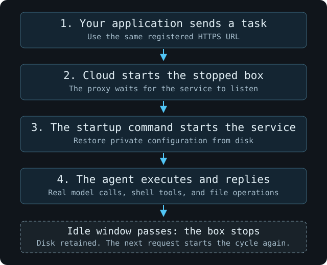

The official Hermes image includes its runtime, tools, and Gateway. Configure Hermes directly, then send a request to its native HTTP API.

Complete the [workstation setup](/cloud/agent-in-box/index#before-you-start). Run all commands below on your workstation.

## Create the box

Use an existing OpenAI Chat Completions-compatible endpoint that supports tool calls. In `create.py`, set `Secret.hosts` to its hostname, without the scheme or path.

Save `create.py`. The prompt reads the real model key on your workstation; only BoxLite's `Secret` configuration receives it.

```python create.py
import asyncio
from getpass import getpass
import boxlite

async def main():
    runtime = boxlite.Boxlite.rest(boxlite.BoxliteRestOptions.from_env())
    try:
        box = await runtime.create(
            boxlite.BoxOptions(
                image="docker.io/nousresearch/hermes-agent@sha256:a11574b7fe8e1631d7d88d556677dac693bc058abf558cdeb899155688c1bf05",
                cpus=2, memory_mib=4096, disk_size_gb=10,
                auto_stop=0, auto_delete=0, detach=True,
                cmd=["gateway", "run"],
                network=boxlite.NetworkSpec(inbound=boxlite.InboundNetworkSpec(mode="enabled")),
                env=[("SSL_CERT_FILE", "/etc/ssl/certs/ca-certificates.crt")],
                secrets=[boxlite.Secret(
                    name="model",
                    value=getpass("Model provider API key: "),
                    hosts=["<YOUR_MODEL_HOST>"],
                )],
            ),
            name="hermes-agent",
        )
        print(box.id)
        await box.start()
    except Exception as exc:
        raise SystemExit(f"{type(exc).__name__}: inspect hermes-agent before retrying creation.") from None
    finally:
        runtime.close()

asyncio.run(main())
```

```bash
python3 create.py
```

The official image entrypoint and `gateway run` restore Gateway on every boot. This image digest was used for verification.

## Configure Hermes

Save these two files on your workstation. Set `model.base_url` to your endpoint's API base URL and `model.default` to its model ID. These are [Hermes's native model settings](https://hermes-agent.nousresearch.com/docs/user-guide/configuration).

Keep `<BOXLITE_SECRET:model>` unchanged. `API_SERVER_KEY` is a separate credential for callers of your Gateway.

```yaml config.yaml
model:
  provider: custom
  default: <MODEL_ID>
  base_url: https://<YOUR_MODEL_HOST>/v1
  api_mode: chat_completions
  key_env: OPENAI_API_KEY
terminal:
  backend: local
```

```bash .env
OPENAI_API_KEY='<BOXLITE_SECRET:model>'
API_SERVER_ENABLED=true
API_SERVER_HOST=0.0.0.0
API_SERVER_PORT=8642
API_SERVER_KEY='<YOUR_RANDOM_GATEWAY_KEY>'
```

Use a separate random key for Gateway callers. You can generate one with `python3 -c 'import secrets; print(secrets.token_hex(32))'`.

Keep these files outside Git. Upload them and set ownership for Hermes:

```bash
chmod 600 config.yaml .env
boxlite cp config.yaml hermes-agent:/opt/data/config.yaml
boxlite cp .env hermes-agent:/opt/data/.env
boxlite exec hermes-agent -- sh -c \
  'chown 10000:10000 /opt/data/config.yaml /opt/data/.env && chmod 600 /opt/data/config.yaml /opt/data/.env'
boxlite restart hermes-agent
boxlite network tunnel hermes-agent 8642
```

If `restart` reports `State change in progress`, inspect the box until its state settles. For a `stopped` box, run `boxlite start hermes-agent`; for a `running` box, retry `boxlite restart hermes-agent`. Then register the tunnel if the previous command did not reach that step.

## Send a task

Replace `<YOUR_TUNNEL_URL>` with the returned URL. Load the Gateway credential from your local `.env`. Check readiness before sending the first task:

```bash
. ./.env
curl --fail-with-body --max-time 30 '<YOUR_TUNNEL_URL>/health' \
  -H "Authorization: Bearer $API_SERVER_KEY"
```

Retry this health request after a few seconds while Gateway starts. Once it succeeds, send the task:

```bash
. ./.env
curl --fail-with-body --max-time 300 '<YOUR_TUNNEL_URL>/v1/chat/completions' \
  -H "Authorization: Bearer $API_SERVER_KEY" \
  -H 'Content-Type: application/json' \
  -d '{"model":"hermes-agent","messages":[{"role":"user","content":"Run this exact shell command with your terminal tool: echo HERMES_READY > /opt/data/proof.txt && cat /opt/data/proof.txt"}],"stream":false}'
boxlite exec hermes-agent -- cat /opt/data/proof.txt
# HERMES_READY
```

Wait for Gateway to become ready after the restart. A successful task has `finish_reason: "stop"` and the expected file content.

**Hermes is ready.** Any client supporting its [Gateway API](https://hermes-agent.nousresearch.com/docs/user-guide/features/api-server) can submit tasks. No example-specific request client is required.

## Optional: wake on a request

Keep `auto_stop=0` to leave Gateway running. To stop between requests, set `auto_stop=120` in `create.py` and keep [wake on access](/cloud/box-lifecycle#wake-on-access) enabled. Choose an idle interval that fits your workload.

### Restore Gateway when the box starts

The create script preserves the official image entrypoint and saves `gateway run` as its command. The configuration under `/opt/data` and registered port 8642 let the same HTTPS URL reach Gateway after a restart.

Starting Gateway once through `exec` would not save a startup command for subsequent boots. Use the image entrypoint and command from this guide for request-triggered startup.

### Check idle stop and request-triggered wake



1. Complete the first task above, which creates `/opt/data/proof.txt`.
2. Stop sending service requests. Use `boxlite inspect hermes-agent` until the state is `stopped`.
3. Send the request below to the same URL, without calling `start`, `exec`, or `cp` first.

Load the Gateway credential from the local `.env` created above:

```bash
. ./.env
curl --fail-with-body --max-time 300 '<YOUR_TUNNEL_URL>/v1/chat/completions' \
  -H "Authorization: Bearer $API_SERVER_KEY" \
  -H 'Content-Type: application/json' \
  -d '{"model":"hermes-agent","messages":[{"role":"user","content":"Run this exact shell command with your terminal tool: echo HERMES_AWAKE > /opt/data/awake.txt && cat /opt/data/awake.txt"}],"stream":false}'
```

The request starts the box, its saved command restores Gateway, and Hermes executes the task. After the response, independently verify both files:

```bash
boxlite exec hermes-agent -- cat /opt/data/proof.txt /opt/data/awake.txt
# HERMES_READY
# HERMES_AWAKE
```

The old file checks disk persistence; the new file checks that the awakened agent used its tools. The provider request also exercises the saved Secret substitution after restart. A chat reply alone does not establish either result.

If Cloud returns `503 BOX_STARTING`, wait for its `Retry-After` interval and retry. A timeout has an unknown outcome; inspect the task's result before submitting it again.

<Note>
  Gateway starts as a new process after the box wakes. Do not poll its health endpoint while waiting for idle stop: service traffic can keep the box awake.
</Note>

For lifecycle controls and background jobs, see [Cloud lifecycle](/cloud/box-lifecycle). Retained disks can still incur [storage charges](/cloud/box-costs).

## When you are finished

```bash
boxlite stop hermes-agent
# To delete the box and its files:
boxlite rm --force hermes-agent
```
