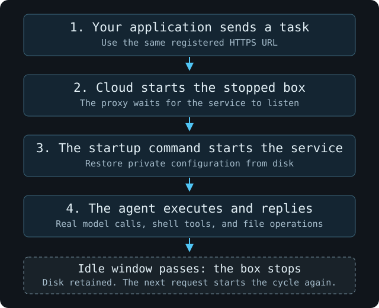

An agent service can keep running, or start when a request arrives. BoxLite handles the box lifecycle; the agent keeps its own API and configuration.

This example uses **Hermes Gateway's native API**. Claude Code, Codex, Pi, and OpenCode can be driven directly with the `boxlite exec` commands in their deployment guides. A custom HTTP wrapper is an application choice, not a prerequisite for deploying those CLIs.

## Save the service's startup command

Follow [Deploy Hermes](/cloud/agent-in-box/hermes). Its `create.py` script preserves the official image entrypoint and sets `gateway run` as the command. Every box start therefore restores Gateway from its saved configuration.

Installing a service and starting it once through `exec` does not configure it to start on subsequent boots. For another image, preserve its service entrypoint or set `BoxOptions.entrypoint` to save your startup executable.

Keep `auto_stop=0` if the service should stay running. To try automatic idle stopping, use `auto_stop=120` in the Hermes create script instead. Choose a longer interval for work that needs one.

## Reach the native API

Hermes listens on port 8642 in that guide. Register it with Cloud:

```bash
boxlite network tunnel hermes-agent 8642
```

Send the guide's authenticated `POST /v1/chat/completions` request to the returned URL. Use Hermes's `API_SERVER_KEY`; no BoxLite-specific task envelope or request client is needed.

A successful request and an independently verified file complete the deployment. **The lifecycle check below is optional.**

## Optional: stop and wake

Run this only when you chose an idle-stop interval.



1. Complete the Hermes guide's first task, which creates `/opt/data/proof.txt`.
2. Stop sending service requests. Use `boxlite inspect hermes-agent` until the state is `stopped`.
3. Send the request below to the same URL, without calling `start`, `exec`, or `cp` first.

Load the Gateway credential from the local `.env` created in the Hermes guide:

```bash
. ./.env
curl --fail-with-body --max-time 300 '<YOUR_TUNNEL_URL>/v1/chat/completions' \
  -H "Authorization: Bearer $API_SERVER_KEY" \
  -H 'Content-Type: application/json' \
  -d '{"model":"hermes-agent","messages":[{"role":"user","content":"Run this exact shell command with your terminal tool: echo HERMES_AWAKE > /opt/data/awake.txt && cat /opt/data/awake.txt"}],"stream":false,"model_options":{"reasoning":{"enabled":false}}}'
```

This short check disables model reasoning through Hermes's native `model_options`. The request starts the box, its saved command restores Gateway, and Hermes executes the task. After the response, independently verify both files:

```bash
boxlite exec hermes-agent -- cat /opt/data/proof.txt /opt/data/awake.txt
# HERMES_READY
# HERMES_AWAKE
```

The old file checks disk persistence; the new file checks that the awakened agent used its tools. The provider request also exercises the saved Secret substitution after restart. A chat reply alone does not establish either result.

If Cloud returns `503 BOX_STARTING`, wait for its `Retry-After` interval and retry. A timeout has an unknown outcome; inspect the task's result before submitting it again.

<Note>
  This is disk-preserving **stop/start**, not a process-memory snapshot. Do not poll Gateway's health endpoint while waiting for idle stop: service traffic can keep the box awake.
</Note>

## Choose the lifecycle for your workload

Keep the service running for background work or when a startup delay is unacceptable. Use idle stopping for intermittent requests that can wait for startup. See [Cloud lifecycle](/cloud/box-lifecycle) for the product controls.

For cleanup, use the [Hermes guide's stop and remove commands](/cloud/agent-in-box/hermes#when-you-are-finished). Retained disks can still incur storage charges; see [Box costs](/cloud/box-costs).
